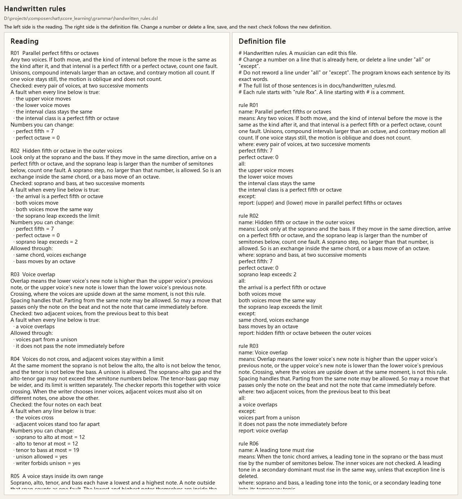
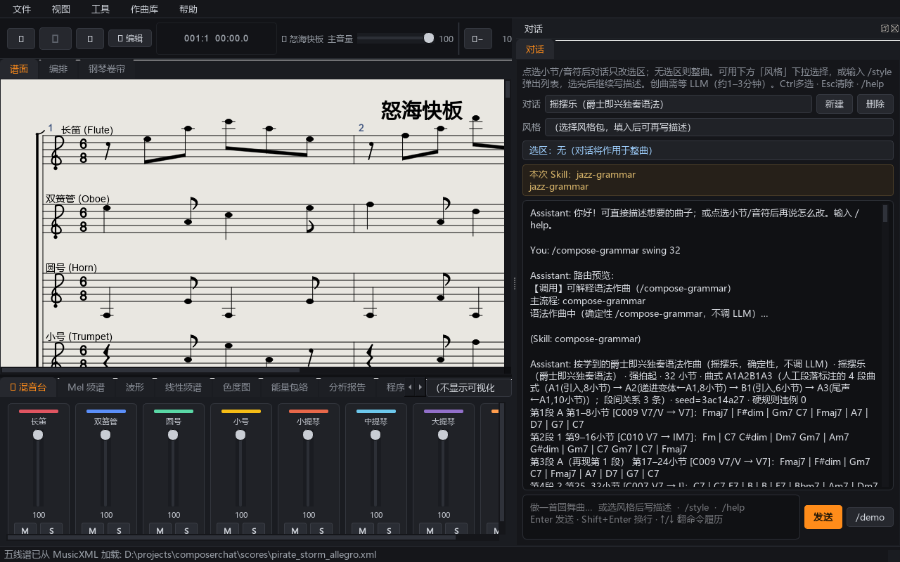
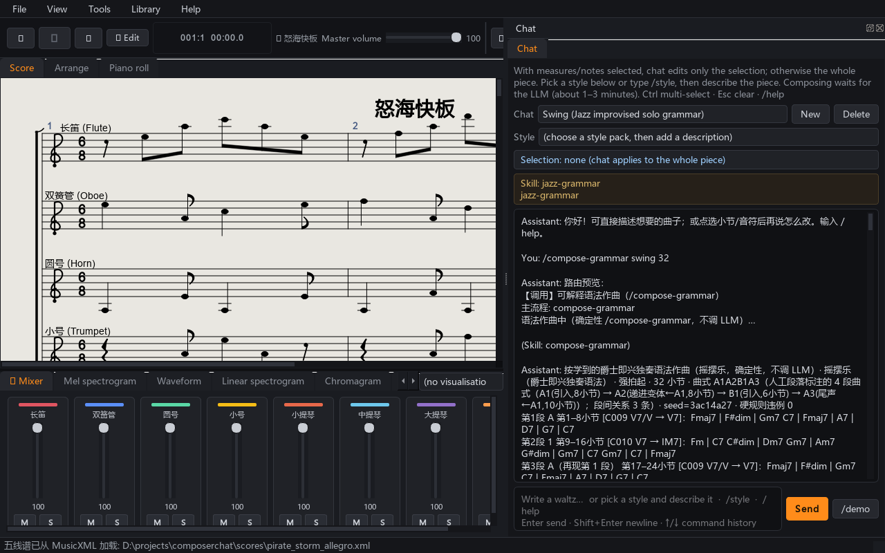

# Score Studio main-feature test report

- When: 2026-11-09 09:21:35
- Platform: Windows, Qt offscreen
- Result: **23/23 passed**, 0 failed

## Summary

| Section | Check | Result | Detail |
| --- | --- | --- | --- |
| Handwritten rules DSL | R01–R11 present | PASS | 12 rules + shared |
| Handwritten rules DSL | shared suspension rule | PASS |  |
| Handwritten rules DSL | English must-lines for R01 | PASS | the upper voice moves |
| Handwritten rules DSL | cadence lock defaults | PASS | beats=3 soprano=2 |
| Handwritten rules DSL | parallel fifth detection | PASS |  |
| Handwritten rules DSL | spacing allows unison | PASS |  |
| Handwritten rules DSL | spacing rejects crossing | PASS |  |
| Handwritten rules DSL | editing the leap limit changes R02 | PASS |  |
| Compose and check | grammar.yaml loads | PASS | grammar.yaml |
| Compose and check | major draft has zero violations | PASS | violations=0 |
| Compose and check | major draft has beats and phrases | PASS | beats=48 phrases=6 |
| Compose and check | same seed is identical | PASS |  |
| Compose and check | minor draft has zero violations | PASS | violations=0 |
| Compose and check | each beat names a learned rule | PASS |  |
| Interface language | English default | PASS | en |
| Interface language | Help menu translates | PASS | 'Help' / '帮助' |
| UI | load sample MusicXML | PASS | pirate_storm_allegro.xml; measures=32; title='怒海快板' |
| UI | main window screenshot | PASS | 201572 bytes |
| UI | Help menu lists Handwritten rules | PASS | 帮助文档（完整 · 每条带示例）, 查看单项说明（命令/功能）…, 设计理念 · 护城河, 编辑教程 · 莫扎特小夜曲（16小节）, Handwritten rules, , 专业文档（命令/功能实测验证版） |
| UI | handwritten rules window screenshot | PASS | 264204 bytes |
| UI | Language menu present | PASS | 中文, English |
| UI | Chinese UI screenshot | PASS | 201572 bytes |
| UI | Help menu screenshot | PASS | 179587 bytes |

## Screenshots

### main window screenshot

### handwritten rules window screenshot

### Chinese UI screenshot

### Help menu screenshot

## Related pytest

Also run: `tests/test_handwritten_rule_dsl.py`, `tests/test_check_refined.py`, `tests/test_i18n.py` → **17 passed**.

## What was covered

- English handwritten-rules DSL (R01–R11 + shared), including an edit that changes R02.
- Chorale compose for major and minor with a fixed seed, requiring zero violations.
- Interface language switch between English and Chinese.
- Desktop window: load a sample MusicXML, open Handwritten rules, capture the Help menu.

## Notes

- UI tests run with `QT_QPA_PLATFORM=offscreen` so they do not need a display.
- FluidSynth playback and MIDI keyboard are not part of this report.
- Re-run with: `python tests/test_main_features_report.py`
