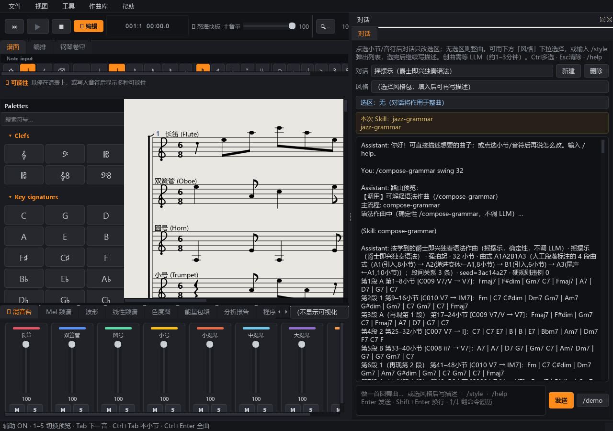
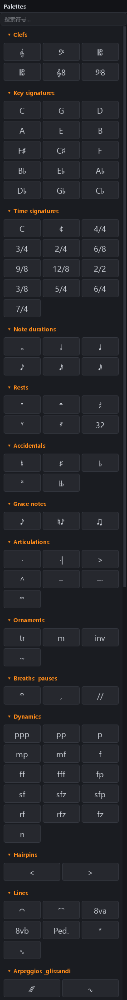

# Palette symbols test report

- Generated: 2026-11-09T10:13:46
- Total: **153**  ·  Pass: **153**  ·  Fail: **0**

## Screenshots

## Results

| Section | ID | Label | Result | Detail |
|---|---|---|---|---|
| Clefs | `clef:TREBLE` | G | PASS | clef=ClefType.TREBLE |
| Clefs | `clef:BASS` | F | PASS | clef=ClefType.BASS |
| Clefs | `clef:ALTO` | C | PASS | clef=ClefType.ALTO |
| Clefs | `clef:TENOR` | Cten | PASS | clef=ClefType.TENOR |
| Clefs | `clef:TREBLE_8VB` | G8 | PASS | clef=ClefType.TREBLE_8VB |
| Clefs | `clef:BASS_8VB` | F8 | PASS | clef=ClefType.BASS_8VB |
| Key signatures | `key:0` | C | PASS | key.sharps=0 |
| Key signatures | `key:1` | G | PASS | key.sharps=1 |
| Key signatures | `key:2` | D | PASS | key.sharps=2 |
| Key signatures | `key:3` | A | PASS | key.sharps=3 |
| Key signatures | `key:4` | E | PASS | key.sharps=4 |
| Key signatures | `key:5` | B | PASS | key.sharps=5 |
| Key signatures | `key:6` | F# | PASS | key.sharps=6 |
| Key signatures | `key:7` | C# | PASS | key.sharps=7 |
| Key signatures | `key:-1` | F | PASS | key.sharps=-1 |
| Key signatures | `key:-2` | Bb | PASS | key.sharps=-2 |
| Key signatures | `key:-3` | Eb | PASS | key.sharps=-3 |
| Key signatures | `key:-4` | Ab | PASS | key.sharps=-4 |
| Key signatures | `key:-5` | Db | PASS | key.sharps=-5 |
| Key signatures | `key:-6` | Gb | PASS | key.sharps=-6 |
| Key signatures | `key:-7` | Cb | PASS | key.sharps=-7 |
| Time signatures | `time:common` | C | PASS | time=4/4 sym=common |
| Time signatures | `time:cut` | ¢ | PASS | time=2/2 sym=cut |
| Time signatures | `time:4/4` | 4/4 | PASS | time=4/4 sym=None |
| Time signatures | `time:3/4` | 3/4 | PASS | time=3/4 sym=None |
| Time signatures | `time:2/4` | 2/4 | PASS | time=2/4 sym=None |
| Time signatures | `time:6/8` | 6/8 | PASS | time=6/8 sym=None |
| Time signatures | `time:9/8` | 9/8 | PASS | time=9/8 sym=None |
| Time signatures | `time:12/8` | 12/8 | PASS | time=12/8 sym=None |
| Time signatures | `time:2/2` | 2/2 | PASS | time=2/2 sym=None |
| Time signatures | `time:3/8` | 3/8 | PASS | time=3/8 sym=None |
| Time signatures | `time:5/4` | 5/4 | PASS | time=5/4 sym=None |
| Time signatures | `time:6/4` | 6/4 | PASS | time=6/4 sym=None |
| Time signatures | `time:7/4` | 7/4 | PASS | time=7/4 sym=None |
| Note durations | `dur:WHOLE` | 1 | PASS | ctrl=NoteDuration.WHOLE note=NoteDuration.THIRTY_SECOND |
| Note durations | `dur:HALF` | 1/2 | PASS | ctrl=NoteDuration.HALF note=NoteDuration.THIRTY_SECOND |
| Note durations | `dur:QUARTER` | 1/4 | PASS | ctrl=NoteDuration.QUARTER note=NoteDuration.THIRTY_SECOND |
| Note durations | `dur:EIGHTH` | 1/8 | PASS | ctrl=NoteDuration.EIGHTH note=NoteDuration.THIRTY_SECOND |
| Note durations | `dur:SIXTEENTH` | 1/16 | PASS | ctrl=NoteDuration.SIXTEENTH note=NoteDuration.THIRTY_SECOND |
| Note durations | `dur:THIRTY_SECOND` | 1/32 | PASS | ctrl=NoteDuration.THIRTY_SECOND note=NoteDuration.THIRTY_SECOND |
| Rests | `rest:WHOLE` | r1 | PASS | tool=rest duration=NoteDuration.WHOLE |
| Rests | `rest:HALF` | r2 | PASS | tool=rest duration=NoteDuration.HALF |
| Rests | `rest:QUARTER` | r4 | PASS | tool=rest duration=NoteDuration.QUARTER |
| Rests | `rest:EIGHTH` | 8th | PASS | tool=rest duration=NoteDuration.EIGHTH |
| Rests | `rest:SIXTEENTH` | 16 | PASS | tool=rest duration=NoteDuration.SIXTEENTH |
| Rests | `rest:THIRTY_SECOND` | 32 | PASS | tool=rest duration=NoteDuration.THIRTY_SECOND |
| Accidentals | `acc:NATURAL` | nat | PASS | ctrl=Accidental.NATURAL note=None |
| Accidentals | `acc:SHARP` | # | PASS | ctrl=Accidental.SHARP note=None |
| Accidentals | `acc:FLAT` | b | PASS | ctrl=Accidental.FLAT note=None |
| Accidentals | `acc:DOUBLE_SHARP` | ## | PASS | ctrl=Accidental.DOUBLE_SHARP note=None |
| Accidentals | `acc:DOUBLE_FLAT` | bb | PASS | ctrl=Accidental.DOUBLE_FLAT note=None |
| Grace notes | `grace_appog` | app | PASS | grace=True |
| Grace notes | `grace_acciac` | acc | PASS | grace=True |
| Grace notes | `grace` | gr | PASS | grace=True |
| Articulations | `staccato` | · | PASS | mark present: staccato |
| Articulations | `staccatissimo` | ·| | PASS | mark present: staccatissimo |
| Articulations | `accent` | > | PASS | mark present: accent |
| Articulations | `marcato` | ^ | PASS | mark present: marcato |
| Articulations | `tenuto` | – | PASS | mark present: tenuto |
| Articulations | `portato` | –· | PASS | mark present: portato |
| Articulations | `fermata` | U | PASS | mark present: fermata |
| Ornaments | `trill` | tr | PASS | mark present: trill |
| Ornaments | `mordent` | m | PASS | mark present: mordent |
| Ornaments | `inverted_mordent` | inv | PASS | mark present: inverted_mordent |
| Ornaments | `turn` | S | PASS | mark present: turn |
| Breaths & pauses | `fermata` | U | PASS | mark present: fermata |
| Breaths & pauses | `breath` | , | PASS | mark present: breath |
| Breaths & pauses | `caesura` | // | PASS | mark present: caesura |
| Dynamics | `dyn:ppp` | ppp | PASS | measure.dynamic='ppp' |
| Dynamics | `dyn:pp` | pp | PASS | measure.dynamic='pp' |
| Dynamics | `dyn:p` | p | PASS | measure.dynamic='p' |
| Dynamics | `dyn:mp` | mp | PASS | measure.dynamic='mp' |
| Dynamics | `dyn:mf` | mf | PASS | measure.dynamic='mf' |
| Dynamics | `dyn:f` | f | PASS | measure.dynamic='f' |
| Dynamics | `dyn:ff` | ff | PASS | measure.dynamic='ff' |
| Dynamics | `dyn:fff` | fff | PASS | measure.dynamic='fff' |
| Dynamics | `dyn:fp` | fp | PASS | measure.dynamic='fp' |
| Dynamics | `dyn:sf` | sf | PASS | measure.dynamic='sf' |
| Dynamics | `dyn:sfz` | sfz | PASS | measure.dynamic='sfz' |
| Dynamics | `dyn:sfp` | sfp | PASS | measure.dynamic='sfp' |
| Dynamics | `dyn:rf` | rf | PASS | measure.dynamic='rf' |
| Dynamics | `dyn:rfz` | rfz | PASS | measure.dynamic='rfz' |
| Dynamics | `dyn:fz` | fz | PASS | measure.dynamic='fz' |
| Dynamics | `dyn:n` | n | PASS | measure.dynamic='n' |
| Hairpins | `crescendo` | < | PASS | hairpin_start='crescendo' |
| Hairpins | `diminuendo` | > | PASS | hairpin_start='diminuendo' |
| Lines | `tie` | tie | PASS | tie_start=True tie_end=False |
| Lines | `slur` | slur | PASS | slur_start=True slur_end=False |
| Lines | `ottava_8va` | 8va | PASS | mark present: ottava_8va |
| Lines | `ottava_8vb` | 8vb | PASS | mark present: ottava_8vb |
| Lines | `pedal` | Ped. | PASS | mark present: pedal |
| Lines | `pedal_up` | * | PASS | mark present: pedal_up |
| Lines | `glissando` | gliss | PASS | mark present: glissando |
| Arpeggios & glissandi | `arpeggio` | arp | PASS | mark present: arpeggio |
| Arpeggios & glissandi | `glissando` | gliss | PASS | mark present: glissando |
| Tremolos | `tremolo` | trem | PASS | mark present: tremolo |
| Tremolos | `tremolo2` | trem2 | PASS | mark present: tremolo2 |
| Fingering | `finger:1` | 1 | PASS | mark present: finger:1 |
| Fingering | `finger:2` | 2 | PASS | mark present: finger:2 |
| Fingering | `finger:3` | 3 | PASS | mark present: finger:3 |
| Fingering | `finger:4` | 4 | PASS | mark present: finger:4 |
| Fingering | `finger:5` | 5 | PASS | mark present: finger:5 |
| Voltas | `volta:1` | 1. | PASS | volta='1' |
| Voltas | `volta:2` | 2. | PASS | volta='2' |
| Voltas | `volta:1,2` | 1,2 | PASS | volta='1,2' |
| Voltas | `volta:` | × | PASS | volta=None |
| Barlines | `bar:regular` | | | PASS | left=None right=None |
| Barlines | `bar:double` | || | PASS | left=None right=double |
| Barlines | `bar:final` | |] | PASS | left=None right=final |
| Barlines | `bar:dashed` | ·|· | PASS | left=None right=dashed |
| Barlines | `bar:repeat_start` | |: | PASS | left=repeat_start right=dashed |
| Barlines | `bar:repeat_end` | :| | PASS | left=repeat_start right=repeat_end |
| Tuplets | `tuplet3` | 3 | PASS | tuplet=(3, 2) |
| Tuplets | `tuplet5` | 5 | PASS | tuplet=(5, 4) |
| Tuplets | `tuplet6` | 6 | PASS | tuplet=(6, 5) |
| Tuplets | `tuplet7` | 7 | PASS | tuplet=(7, 6) |
| Tempo | `tempo:Largo` | Largo | PASS | tempo_mark='Largo' |
| Tempo | `tempo:Adagio` | Adagio | PASS | tempo_mark='Adagio' |
| Tempo | `tempo:Andante` | Andante | PASS | tempo_mark='Andante' |
| Tempo | `tempo:Moderato` | Moderato | PASS | tempo_mark='Moderato' |
| Tempo | `tempo:Allegro` | Allegro | PASS | tempo_mark='Allegro' |
| Tempo | `tempo:Presto` | Presto | PASS | tempo_mark='Presto' |
| Tempo | `tempo:Rit.` | Rit. | PASS | tempo_mark='Rit.' |
| Tempo | `tempo:accel.` | accel. | PASS | tempo_mark='accel.' |
| Tempo | `tempo:a tempo` | a tempo | PASS | tempo_mark='a tempo' |
| Tempo | `tempo_bpm:120` | =120 | PASS | meas.bpm=120 score.tempo=120 |
| Tempo | `tempo_bpm:92` | =92 | PASS | meas.bpm=92 score.tempo=92 |
| Tempo | `tempo_bpm:60` | =60 | PASS | meas.bpm=60 score.tempo=60 |
| Repeats & jumps | `text:D.C.` | D.C. | PASS | text='D.C.' |
| Repeats & jumps | `text:D.S.` | D.S. | PASS | text='D.S.' |
| Repeats & jumps | `text:Fine` | Fine | PASS | text='Fine' |
| Repeats & jumps | `text:To Coda` | Coda | PASS | text='To Coda' |
| Repeats & jumps | `text:Segno` | Segno | PASS | text='Segno' |
| Repeats & jumps | `rehearsal:A` | A | PASS | rehearsal='A' |
| Repeats & jumps | `rehearsal:B` | B | PASS | rehearsal='B' |
| Repeats & jumps | `rehearsal:C` | C | PASS | rehearsal='C' |
| Chord symbols | `chord:C` | C | PASS | chord='C' |
| Chord symbols | `chord:Am` | Am | PASS | chord='Am' |
| Chord symbols | `chord:G7` | G7 | PASS | chord='G7' |
| Chord symbols | `chord:F` | F | PASS | chord='F' |
| Chord symbols | `chord:Dm` | Dm | PASS | chord='Dm' |
| Chord symbols | `chord:Em` | Em | PASS | chord='Em' |
| Chord symbols | `chord:` | × | PASS | chord=None |
| Text | `text:dolce` | dolce | PASS | text='dolce' |
| Text | `text:espressivo` | espress. | PASS | text='espressivo' |
| Text | `text:legato` | legato | PASS | text='legato' |
| Text | `text:cantabile` | cantabile | PASS | text='cantabile' |
| Text | `text:poco a poco` | poco… | PASS | text='poco a poco' |
| Layout | `layout:system` | sys | PASS | layout='system' |
| Layout | `layout:page` | Pg | PASS | layout='page' |
| Score tools | `tool:add_measures` | +小节 | PASS | tool action wired (dialog/mutation skipped) |
| Score tools | `tool:add_part` | +声部 | PASS | tool action wired (dialog/mutation skipped) |
| Score tools | `tool:accomp` | 配乐 | PASS | tool action wired (dialog/mutation skipped) |
